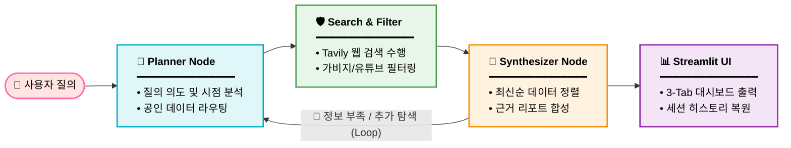

# 자연어 요청 기반 데이터 수집 및 리포팅 AI 에이전트
> **"정보 과부하 시대"** 신뢰할 수 있는 팩트와 근거에 기반하여 고품질 데이터 수집 및 분석하여 리포트를 자동 생성하는 지능형 업무 자동화 에이전트
---
## 1. 프로젝트 개요(Overview)
### ◆ 개발 배경
* **정보 신뢰성 저하 :** 기업 및 기관의 보고서 및 기획안 작성 업무 과정에서 발생하는 과도한 정보 탐색 시간과 주관적 정보 범람 문제 해결
* **개인차 해소 :** 사용자의 검색능력 및 자질에 따라 수집되는 정보의 양과 질의 격차가 드러나는 사용자 경험 개선
### ◆ 목적
* **오류 최소화 :** 신뢰성 높은 출처 기반의 데이터 수집 및 분석 자동화하여 정보 오차/오류 최소화
* **생산성 증대 :** 자료 탐색 및 리포트 정리 기간 단축하여 업무 생산성을 증대
---
## 2. 핵심 개발기술 스택(Tech Stack)
* **Frontend :** `Streamlit` (반응형 모던 대시보드, UI, 탭, 미리보기 모달, 세션 기반 히스토리 관리 기능)
* **Orchestration & Workflow :** `LangGraph` (에이전트 상태 관리 및 안정적인 클린 파이프라인 구축)
* **AI & LLM :** `OpenAI:GPT-4o-mini` (질의 의도 분석, 데이터 구조 설계, 리포트 합성 및 후속 질문 생성 등)
* **Search & Security :** `Tavily Search API` (고급 웹 검색, 유튜브·커뮤니티·소셜 미디어 도메인 차단, 인코딩 가비지 및 개인정보 유출 위험 문서 필터링)
---
## 3. 주요 기능 및 아키텍처(Key Features)

* **범용 공인 데이터 API 다중 라우팅(`Planner Node`) :** 사용자의 질의 의도 및 시점 분석, 정형 통계 데이터 기반 리포트 신뢰도 수치 상승효과
* **철저한 보안 및 노이즈 차단 아키텍처(`Search & Filter Node`) :** 유튜브 및 커뮤니티 도메인 배제, 가비지 데이터 필터링, 개인정보 보호
* **시점 감지 기반 데이터 수집(`Synthesizer Node`)**
* **모던 대시보드 및 세션 히스토리 UX :**
  * **3-TAB 구조 :** 종합 리포트 대시보드, 실시간 수집 원시 데이터 및 타임라인 로그, AI 팩트체크 검증 메트릭 제공
  * **세션 복원 :** 좌측 사이드바를 통해 이전 검색 기록을 유지하고 원클릭으로 세션을 복원할 수 있는 편의성 제공
---
## 4. 시연 영상(Screenshots / Demo)
## 🎬 시연 영상 및 사용법 (Demo & Usage)

### 1. 🎯 질의어 입력 및 AI 에이전트 구동
사용자가 분석하고자 하는 질문을 입력하면 AI 에이전트가 타겟팅 키워드를 추출하고 탐색 파이프라인을 실행합니다.

  

---

### 2. 📋 AI 종합 리포트 결과 출력
공인 정형 데이터를 최우선순위로 교차 검증하여 완성된 하이브리드 리포트와 신뢰도 요약 지표를 한눈에 확인할 수 있습니다.

  

---

### 3. 🔍 검증 출처 원문 미리보기 모달
리포트 하단의 근거 출처 카드를 클릭하면 원문 스니펫과 URL을 모달 팝업으로 띄워 팩트를 직접 검증할 수 있습니다.

  

---

### 4. 🔄 실시간 라이브 데이터 갱신
`실시간 라이브 탐색` 탭에서 최신 자료를 누적 수집하고 에이전트의 구동 타임라인 로그를 투명하게 모니터링합니다.

  

---

### 5. 📜 사이드바 검색 히스토리 및 세션 복원
이전에 진행했던 리서치 기록을 사이드바 히스토리 목록에서 클릭 한 번으로 순식간에 복원하여 재확인할 수 있습니다.

  

---
## 5. 기대 효과 및 성과
* **업무 생산성 극대화 :** 자료 검색&수집&정리 단계의 수작업 공수를 줄여 보고서 작성까지의 총 소요 시간을 획기적으로 단축
* **할루시네이션 및 오류 방지/최소화 :** 정형 공인 데이터를 최우선순위로 팩트로 삼고 신뢰도 높은 언론/기사/뉴스를 참조하여 정보의 객관성 보장
