# 자연어 요청 기반 데이터 수집 및 리포팅 AI 에이전트
> **"정보 과부하 시대"** 신뢰할 수 있는 팩트와 근거에 기반하여 고품질 데이터 수집 및 분석하여 리포트를 자동 생성하는 지능형 업무 자동화 에이전트
---
## 1. 프로젝트 개요(Overview)
### ◆ 개발 배경
* **정보 신뢰성 저하 :** 기업 및 기관의 보고서 및 기획안 작성 업무 과정에서 발생하는 과도한 정보 탐색 시간과 주관적 정보 범람 문제 해결
* **개인차 해소 :** 사용자의 검색능력 및 자질에 따라 수집되는 정보의 양과 질의 격차가 드러나는 사용자 경험 개선
### ◆ 목적
* **오류 최소화 :** 신뢰성 높은 출처 기반의 데이터 수집 및 분석 자동화하여 정보 오차/오류 최소화
* **생산성 증대 :** 자료 탐색 및 리포트 정리 기간 단축하여 업무 생산성을 증대
---
## 핵심 개발기술 스택(Tech Stack)
* **Frontend :** `Streamlit` (반응형 모던 대시보드, UI, 탭, 미리보기 모달, 세션 기반 히스토리 관리 기능)
* **Orchestration & Workflow :** `LangGraph` (에이전트 상태 관리 및 안정적인 클린 파이프라인 구축)
* **AI & LLM :** `OpenAI:GPT-4o-mini` (질의 의도 분석, 데이터 구조 설계, 리포트 합성 및 후속 질문 생성 등)
* **Search & Security :** `Tavily Search API` (고급 웹 검색, 유튜브·커뮤니티·소셜 미디어 도메인 차단, 인코딩 가비지 및 개인정보 유출 위험 문서 필터링)
---
## 주요 기능 및 아키텍처(Key Features)

```mermaid
graph LR
    classDef userStyle fill:#FFE4E1,stroke:#FF69B4,stroke-width:2px,color:#000;
    classDef plannerStyle fill:#E0F7FA,stroke:#00ACC1,stroke-width:2px,color:#000;
    classDef filterStyle fill:#E8F5E9,stroke:#43A047,stroke-width:2px,color:#000;
    classDef synthStyle fill:#FFF3E0,stroke:#FB8C00,stroke-width:2px,color:#000;
    classDef uiStyle fill:#F3E5F5,stroke:#8E24AA,stroke-width:2px,color:#000;

    A([👤 사용자 질의]):::userStyle 
    
    B["<table style='min-width: 230px; border-collapse: collapse;'><tr><td align='center'><b>🧠 Planner Node</b></td></tr><tr><td style='border-top: 1px solid #00ACC1; padding-top: 6px; text-align: left;'>• 질의 의도 및 시점 분석<br/>• 공인 데이터 라우팅</td></tr></table>"]:::plannerStyle
    
    C["<table style='min-width: 230px; border-collapse: collapse;'><tr><td align='center'><b>🛡️ Search & Filter</b></td></tr><tr><td style='border-top: 1px solid #43A047; padding-top: 6px; text-align: left;'>• Tavily 웹 검색 수행<br/>• 가비지/유튜브 필터링</td></tr></table>"]:::filterStyle
    
    D["<table style='min-width: 230px; border-collapse: collapse;'><tr><td align='center'><b>📅 Synthesizer Node</b></td></tr><tr><td style='border-top: 1px solid #FB8C00; padding-top: 6px; text-align: left;'>• 최신순 데이터 정렬<br/>• 근거 리포트 합성</td></tr></table>"]:::synthStyle
    
    E["<table style='min-width: 230px; border-collapse: collapse;'><tr><td align='center'><b>📊 Streamlit UI</b></td></tr><tr><td style='border-top: 1px solid #8E24AA; padding-top: 6px; text-align: left;'>• 3-Tab 대시보드 출력<br/>• 세션 히스토리 복원</td></tr></table>"]:::uiStyle

    %% 정방향 파이프라인 흐름
    A --> B
    B --> C
    C --> D
    D --> E
    
    %% LangGraph 피드백 루프
    D -- "🔄 정보 부족 / 추가 탐색 (Loop)" --> B
```

* **범용 공인 데이터 API 다중 라우팅(`Planner Node`) :** 사용자의 질의 의도 및 시점 분석, 정형 통계 데이터 기반 리포트 신뢰도 수치 상승효과
* **철저한 보안 및 노이즈 차단 아키텍처(`Search & Filter Node`) :** 유튜브 및 커뮤니티 도메인 배제, 가비지 데이터 필터링, 개인정보 보호
* **시점 감지 기반 데이터 수집(`Synthesizer Node`)**
* **모던 대시보드 및 세션 히스토리 UX :**
  * **3-TAB 구조 :** 종합 리포트 대시보드, 실시간 수집 원시 데이터 및 타임라인 로그, AI 팩트체크 검증 메트릭 제공
  * **세션 복원 :** 좌측 사이드바를 통해 이전 검색 기록을 유지하고 원클릭으로 세션을 복원할 수 있는 편의성 제공
---
## 기대 효과 및 성과
* **업무 생산성 극대화 :** 자료 검색&수집&정리 단계의 수작업 공수를 대폭 줄여 보고서 작성 소요시간을 획기적으로 단축
* **할루시네이션 및 오류 방지/최소화 :** 정형 공인 데이터를 최우선순위로 팩트 원천으로 삼고 신뢰도 높은 언론/기사/뉴스를 참조하여 정보의 객관성 보장
